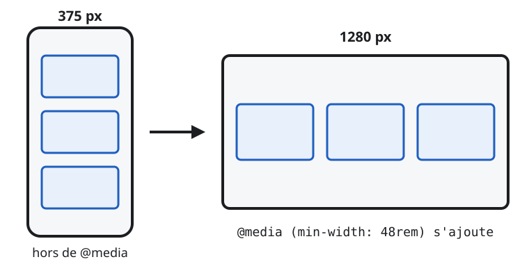

# Mobile first : le téléphone d'abord

**Durée** : 30 minutes.
**But** : écrire d'abord le CSS du téléphone, puis ajouter, dans une
`@media (min-width: …)`, ce qui change sur un grand écran.

## L'idée, autrement

Un écran de téléphone est étroit : les blocs se placent l'un sous l'autre.
C'est déjà ce que fait le navigateur, sans CSS. Le mobile first part de là :

1. **Hors de toute `@media`** : le CSS du téléphone. Il s'applique
   **partout**, sur tous les écrans.
2. **Dans `@media (min-width: 48rem)`** : seulement ce qui **change** quand
   l'écran est large (48rem, soit 768 px, ou plus). Ces règles
   **s'ajoutent** à celles du téléphone, et gagnent quand elles visent
   la même propriété, parce qu'elles sont écrites après.

On n'écrit donc jamais deux fois la même chose : le grand écran ne
contient que les différences.



Une dernière pièce : sans la balise `meta viewport`, le téléphone fait
semblant d'avoir un écran de 980 px, puis rétrécit tout. La page est
alors minuscule, et la `@media` se trompe d'écran.

## Préparer

1. Copiez ce dossier dans `~/dwwm/dwwm-tp/semaine-08/soutien/`
   (voir le `README.md` à la racine du dépôt).
2. Dans le terminal, allez dans la copie :
   `cd ~/dwwm/dwwm-tp/semaine-08/soutien/css-mobile-first-1`
3. Ouvrez la copie dans VS Code : `code .`
   (si la commande est inconnue : ouvrez VS Code,
   puis *Fichier* > *Ouvrir le dossier…*).
4. Ouvrez `index.html` avec Live Preview, puis *Ouvrir dans le navigateur*.
   Ouvrez les outils de développement (touche F12), puis le mode appareil,
   avec une largeur de 375.
5. Lancez les tests : `node --test mobile-first.test.js`

**Vous devez voir** : 5 tests rouges (`fail 5`). C'est normal : rien n'est
encore écrit.

## Les étapes

Tapez le code **et** ses commentaires, à la fin de `style.css`
(sous la dernière ligne), sauf à l'étape 1.

**Étape 1 — La balise meta viewport.** Dans `index.html`, sous la ligne
`<meta charset="utf-8">`, ajoutez :

```html
<meta name="viewport" content="width=device-width, initial-scale=1">
```

**Vous devez voir** : le test de l'étape 1 au vert.

**Étape 2 — Le téléphone : une colonne de cartes.**

```css
/* Pour le téléphone : une grille d'une colonne */
.cartes {
  /* grid : les cartes l'une sous l'autre, avec un écart */
  display: grid;
  /* L'écart entre deux cartes : 16 px */
  gap: 1rem;
}
```

**Vous devez voir** : à 375 px, les trois cartes l'une sous l'autre,
séparées par un espace. À 1280 px : pareil, pour le moment.

**Étape 3 — Le grand écran : trois colonnes.** Sous la règle de l'étape 2 :

```css
/* À partir de 48rem (768 px) : ce qui change */
@media (min-width: 48rem) {
  /* Les cartes : trois colonnes de même largeur */
  .cartes {
    grid-template-columns: repeat(3, 1fr);
  }
}
```

**Vous devez voir** : à 375 px, toujours une colonne ; en élargissant la
fenêtre au-delà de 768 px, les trois cartes côte à côte.

**Étape 4 — Le menu.** Pour le téléphone, les liens l'un sous l'autre ;
sur un grand écran, sur une ligne. Ajoutez d'abord, **au-dessus** de la
`@media`, sous la règle `.cartes` :

```css
/* Pour le téléphone : les liens l'un sous l'autre */
.menu {
  /* flex : les liens se placent les uns après les autres */
  display: flex;
  /* column : en colonne */
  flex-direction: column;
  /* L'écart entre deux liens : 8 px */
  gap: 0.5rem;
}
```

Puis, **dans** la `@media`, sous la règle `.cartes` :

```css
  /* Sur un grand écran : les liens sur une ligne */
  .menu {
    flex-direction: row;
  }
```

**Vous devez voir** : à 375 px, les trois liens l'un sous l'autre ;
au-delà de 768 px, les trois liens sur une ligne.

**Réussi si** : `node --test mobile-first.test.js` affiche `fail 0` ; à
375 px, une colonne et un menu en colonne ; au-delà de 768 px, trois
colonnes et un menu en ligne.

## Enregistrer et envoyer (2 min)

Depuis `~/dwwm/dwwm-tp` :

```bash
git status
git add semaine-08/soutien/css-mobile-first-1
git commit -m "Ajoute l'exercice mobile first"
git push
```

## Aides

1. **Le cours** : semaine 6, [mobile first](https://kevinbdx35.github.io/dwwm-2026-2027/semaines/s06-html-css-suite/mardi.html#apport-mobile-first)
   et [Grid](https://kevinbdx35.github.io/dwwm-2026-2027/semaines/s06-html-css-suite/mardi.html#apport-grid).
2. **L'IA** : CS50.ai. Demandez pourquoi une règle de la `@media` ne
   s'applique pas, pas le code.
3. **MDN** : [@media](https://developer.mozilla.org/fr/docs/Web/CSS/Reference/At-rules/@media),
   [la balise meta viewport](https://developer.mozilla.org/fr/docs/Web/HTML/Reference/Elements/meta/name/viewport).
