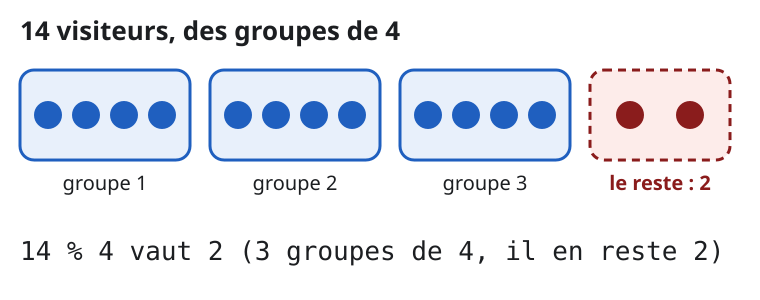
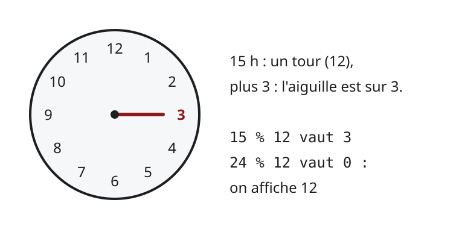

# Le reste de la division (%), avec des dessins

**Durée** : 30 minutes.
**But** : comprendre ce que donne `a % b`, avec deux images :
des groupes de visiteurs, puis une horloge.

## Première image : des groupes

`a % b`, c'est **ce qui reste** quand on fait des groupes de `b` avec `a`
objets. On ne s'intéresse pas au nombre de groupes, seulement au reste.



Avant d'écrire du code, complétez sur une feuille (ou dans `bilan.md`),
en dessinant les groupes s'il le faut :

| Calcul | Groupes complets | Reste |
|---|---|---|
| `14 % 4` | 3 | 2 |
| `12 % 4` | | |
| `3 % 4` | | |
| `9 % 2` | | |
| `10 % 2` | | |

Le reste est toujours plus petit que `b`. Quand il vaut 0, les groupes
tombent juste : `12 % 4` vaut 0, donc 12 est un multiple de 4.
**Pair** veut dire : des groupes de 2, sans reste ; donc `n % 2 === 0`.

## Seconde image : l'horloge

Une horloge de 12 heures repart de 0 après 12 : c'est un reste.



## Préparer

1. Copiez ce dossier dans `~/dwwm/dwwm-tp/semaine-08/soutien/`
   (voir le `README.md` à la racine du dépôt).
2. Dans le terminal, allez dans la copie :
   `cd ~/dwwm/dwwm-tp/semaine-08/soutien/js-modulo-1`
3. Ouvrez la copie dans VS Code : `code .`
   (si la commande est inconnue : ouvrez VS Code,
   puis *Fichier* > *Ouvrir le dossier…*).
4. Ouvrez `index.html` avec Live Preview, puis *Ouvrir dans le navigateur*.
5. Lancez les tests : `node --test logic.test.js`

**Vous devez voir** : 4 tests rouges (`fail 4`), et une page qui affiche des valeurs fausses (-1, null). C'est normal : rien n'est encore écrit.

## Faire les quatre fonctions, dans l'ordre

1. Ouvrez `logic.js`. Chaque fonction a sa consigne en commentaire, avec
   un exemple.
2. Avant d'écrire chaque fonction, calculez son exemple à la main, avec le
   dessin : que doit-elle renvoyer ?
3. Écrivez la fonction, enregistrez, relancez les tests, rechargez la page.
4. **Vous devez voir** : son test au vert, et la page qui change :
   le reste des groupes (1), pair ou impair (2), une liste à lignes
   alternées, claire puis foncée (3), l'heure sur l'horloge quand vous
   changez le champ (4).
5. Cochez la case de `bilan.md`.

<details>
<summary>Indice — 1, leftover</summary>

Une seule ligne : `return` suivi du calcul du reste, avec les deux
paramètres.

</details>

<details>
<summary>Indice — 3, rowClass</summary>

Un `if` sur `isEven(index)` : deux `return`, un pour chaque classe.

</details>

<details>
<summary>Indice — 4, clockHour</summary>

D'abord le reste de `hour` par 12, rangé dans une constante. Puis : si ce
reste vaut 0, on renvoie 12 ; sinon, le reste.

</details>

**Réussi si** : `node --test logic.test.js` affiche `fail 0`, la page
affiche les bons résultats, et le tableau de `bilan.md` est complété.

## Enregistrer et envoyer (2 min)

Depuis `~/dwwm/dwwm-tp` :

```bash
git status
git add semaine-08/soutien/js-modulo-1
git commit -m "Ajoute l'exercice sur le reste de la division"
git push
```

## Aides

1. **Le cours** : semaine 2, [conditions et boucles, l'opérateur reste](https://kevinbdx35.github.io/dwwm-2026-2027/semaines/s02-fondamentaux-js-1/vendredi.html).
2. **L'IA** : CS50.ai. Demandez-lui un autre exemple de la vie courante
   où l'on calcule un reste, pas le code de la fonction.
3. **MDN** : [le reste de la division (%)](https://developer.mozilla.org/fr/docs/Web/JavaScript/Reference/Operators/Remainder).
